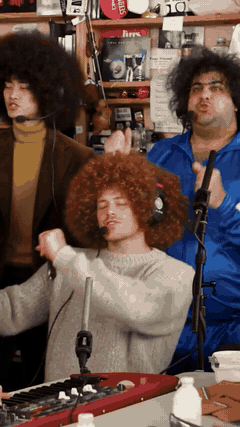
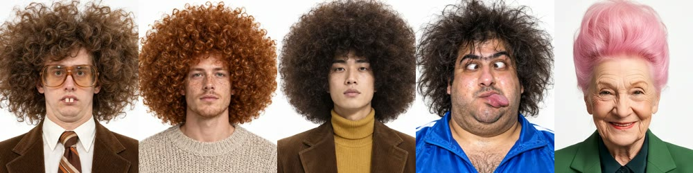

# Outstanding Tiny Desk AI

**The Tiny Desk AI meme, explained — and how to make your own Outstanding Tiny Desk AI video with one photo, or with up to four friends.**

*Our own example, made with [Tiny Desk AI (tinydeskaimeme.com)](https://tinydeskaimeme.com/). Every person in it is AI-generated.*

[Watch the full five-person example with sound, 480p](https://tinydeskaimeme.com/memes/tinydesk/example-118.mp4). The reference portraits are shown below. This published AI example is illustrative, not a guarantee of an individual render. Faces, mouth timing and movement can vary.

## Quick facts

| | |
| --- | --- |
| Meme | "Outstanding" Tiny Desk AI (also called the Tiny Desk meme) |
| Source | Charlie Wilson's NPR Tiny Desk concert, June 2023 — "Outstanding" by the Gap Band |
| Output | 9:16 vertical MP4, about 18 seconds, original sound, 480p or 720p HD |
| Photos | 1 for the lead singer; up to 4 more for keys, two backing singers and sax |
| Price | Same for solo or the full band: from $9.99 ([pricing](https://tinydeskaimeme.com/pricing)) |

## What is the Tiny Desk AI meme?

NPR Music published Charlie Wilson's Tiny Desk concert in June 2023. Tiny Desk AI memes recast people in the band's performance of "Outstanding" using AI-generated imagery.

Why it works: the performance is earnest and instantly recognisable, so any unexpected line-up at the desk becomes the punchline.

More: [the Outstanding Tiny Desk meme, explained](https://tinydeskaimeme.com/what-is-the-tiny-desk-meme).

## The five seats

| Seat | Who you can put there |
| --- | --- |
| Lead singer | You (required) |
| Keys, front row | A friend, or keep the AI musician |
| Backing singer, back row left | A friend, or keep the AI musician |
| Backing singer, back row right | A friend, or keep the AI musician |
| Sax | A friend, or keep the AI musician |

## Make your own

1. Open [Tiny Desk AI](https://tinydeskaimeme.com/) and add a clear, front-facing photo of yourself or an adult who agreed as the lead singer.
2. Optionally add up to four consenting adults, one photo per seat. Unfilled seats keep the AI musicians.
3. Choose 480p (10 credits) or 720p HD (20 credits).
4. Sign in and use a one-time credit pack to start. Rendering time varies. Failed or interrupted renders return their credits automatically; returned credits are not an automatic cash refund. Cash refunds follow the separate refund policy. Check [current pricing](https://tinydeskaimeme.com/pricing).
5. Find the finished video in your Library and download the vertical MP4 with the original sound.

Step-by-step guide: [How to make the Outstanding Tiny Desk AI video](https://tinydeskaimeme.com/how-to-make-tiny-desk-ai). Full band: [cast all five seats](https://tinydeskaimeme.com/templates/tiny-desk-ai-five-person-band).

## Photo tips

- Even light, sharp focus, face to the camera; no heavy filters or sunglasses.
- One person per photo.
- Only yourself or adults who agreed. No celebrities, public figures (including coaches) or minors.

## FAQ

**Does it come with the original sound?** Yes — the finished MP4 uses the original "Outstanding" performance.

**How long is the video?** About 18 seconds, vertical 9:16.

**Does adding friends cost more?** No. One photo or five photos cost the same.

**Which AI model is used for the video?** The current site describes its video generation as using Seedance 2.5.

**Is there a watermark?** No.

**Where can I watch the original?** [NPR](https://www.npr.org/2023/06/05/1179416602/charlie-wilson-tiny-desk-concert) and [NPR Music on YouTube](https://www.youtube.com/watch?v=J3jUEB7qmt8).

## Disclaimer

This project and [Tiny Desk AI](https://tinydeskaimeme.com/) are independent and not affiliated with NPR, Charlie Wilson or the Gap Band. Label AI remakes as AI, and never present one as a real appearance or endorsement.

## More guides

- [How to make a Tiny Desk AI video](https://huggingface.co/blog/trendremakes/how-to-make-tiny-desk-ai-video)
- [Outstanding Tiny Desk AI: make the full 18-second video with your band](https://huggingface.co/blog/trendremakes/outstanding-tiny-desk-ai)
- [Outstanding AI video: 12 ideas for your own Tiny Desk band](https://huggingface.co/blog/trendremakes/outstanding-ai-video)
- [Tiny Desk AI video generator: make the Outstanding video from a photo](https://huggingface.co/blog/dddffgassa/tiny-desk-ai-video-generator)
